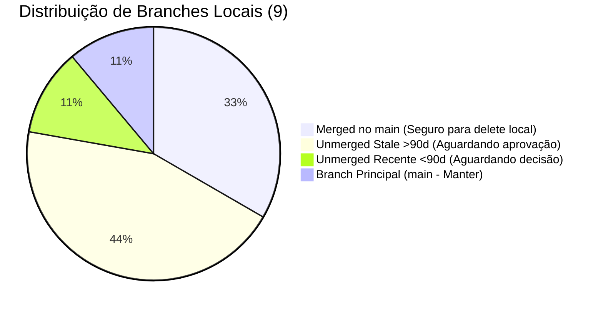

# 🌿 Auditoria de Branches e Worktrees — Ghost System
**Data:** 02 de Novembro de 2026  
**Repositório:** `PORTFOLIO-DANILO-FINAL` (`/Users/danilonovais/PORTFOLIO-DANILO-FINAL`)  
**Status do Workspace:** Branch `main` ativa  
**Total de Branches:** 9 locais · 44 remotas (`origin`)

---

## 📊 1. Resumo Executivo da Auditoria



| Categoria | Locais | Remotas | Ação Recomendada |
| :--- | :---: | :---: | :--- |
| **Merged no main** | 3 | 5 | **Delete seguro** (locais) / Delete remoto sugerido sob aprovação |
| **Unmerged Stale (>90 dias)** | 4 | 20 | **Aguardando aprovação humana** para remoção |
| **Unmerged Recente (≤90 dias)** | 1 | 18 | **Aguardando avaliação técnica** |
| **Produção Ativa (`main`)** | 1 | 1 | **MANTER** |
| **Total** | **9** | **44** | **Nenhuma branch deletada sem aprovação** |

---

## 💻 2. Branches Locais (9 branches)

| Branch Local | Commit | Idade | Status no `main` | Remota (`origin`) | Recomendação Ghost |
| :--- | :---: | :---: | :---: | :---: | :--- |
| `main` | `b8a2fd3f9` | 0d | **Ativa / HEAD** | `origin/main` | **MANTER SEMPRE** |
| `feat/about-origin-migration` | `3cb73b35d` | 2d | **Merged** | Nenhuma (órfã local) | **DELETE LOCAL RECOMENDADO (Seguro)** |
| `feat/portfolio-audit-remediation-2026-09` | `4f6e2239b` | 40d | **Merged** | Nenhuma (órfã local) | **DELETE LOCAL RECOMENDADO (Seguro)** |
| `worktree-add-o-que-me-move-route` | `c02b6c0ed` | 152d | **Merged (Stale)** | Nenhuma (órfã local) | **DELETE LOCAL RECOMENDADO (Seguro)** |
| `audit/video-architecture-refactor` | `cd9eea47b` | 43d | **Unmerged** | `origin/audit/video-architecture-refactor` | **MANTER / AGUARDAR DECISÃO** (em andamento) |
| `claude/weekly-audit-report-2026-06-09` | `57a2fe1c1` | 143d | **Unmerged (Stale)** | Nenhuma (órfã local) | **AGUARDANDO APROVAÇÃO** (Delete local sugerido) |
| `codex/mobile-menu-systemic-fix` | `7114c8e73` | 98d | **Unmerged (Stale)** | `origin/codex/mobile-menu-systemic-fix` | **AGUARDANDO APROVAÇÃO** (Verificar se foi superada) |
| `fix/migrate-cloudflare-workers-opennext` | `e9c35b909` | 116d | **Unmerged (Stale)** | Nenhuma (órfã local) | **AGUARDANDO APROVAÇÃO** (Stack Cloudflare descartada) |
| `worktree-fix-thumb-loader` | `8fd7cc136` | 152d | **Unmerged (Stale)** | Nenhuma (órfã local) | **AGUARDANDO APROVAÇÃO** (Delete local sugerido) |

---

## 🌐 3. Branches Remotas (`origin` — 44 branches)

### 3.1. Remotas Mergeadas no `origin/main` (5 branches — Seguras para delete sob aprovação)
Todas as alterações dessas branches já estão incorporadas na `main`. Podem ser removidas do remote para reduzir poluição:
1. `origin/codex/media-card-system` (`06104ba2b`, 164d atrás) — Stale
2. `origin/danilo-novais-yahoo-com-br/WKSP-1-planning-portfolio-s` (`16aa5652d`, 186d atrás) — Stale
3. `origin/docs/audit-beliefs-ghost-design-v3` (`2444b35be`, 200d atrás) — Stale
4. `origin/feat/qr-scanner-pwa` (`67ba187e7`, 3d atrás) — Recente
5. `origin/worktree-fix-06-que-me-move` (`561eec01b`, 170d atrás) — Stale

### 3.2. Remotas Não Mergeadas e Stale (>90 dias — 20 branches)
Branches de relatórios automatizados antigos, experimentos ou PRs abandonados:
1. `origin/audit-cleanup-report-17253422028984227540` (97d)
2. `origin/audit/weekly-report-4676327557888982331` (166d)
3. `origin/chore-audit-report-12176814106024817247` (160d)
4. `origin/claude/beautiful-rubin-MVYRs` (159d)
5. `origin/claude/beautiful-rubin-nchfig` (124d)
6. `origin/claude/dazzling-euler-ZhWMf` (161d)
7. `origin/claude/dazzling-euler-ad7pi8` (126d)
8. `origin/claude/dazzling-euler-mp4s71` (133d)
9. `origin/claude/weekly-audit-report-2026-05-19` (166d)
10. `origin/claude/weekly-audit-report-2026-06-16` (138d)
11. `origin/claude/weekly-audit-report-2026-06-23` (131d)
12. `origin/codex/ghost-portfolio-hero-pr` (163d)
13. `origin/codex/mobile-menu-systemic-fix` (98d)
14. `origin/codex/sobre-origin-a11y-fixes` (168d)
15. `origin/codex/weekly-cleanup` (180d)
16. `origin/danilonovaisv-patch-1` (103d)
17. `origin/docs/ghost-design-updates-12336613816235341544` (141d)
18. `origin/fix/audit-remediation-phase1` (184d)
19. `origin/worktree-audit-fixes` (171d)
20. `origin/worktree-responsive-video-plan` (167d)

### 3.3. Remotas Não Mergeadas Recentes (≤90 dias — 18 branches)
Geradas por bots de CI, Jules ou auditorias automáticas:
1. `origin/audit/video-architecture-refactor` (43d — pareada com branch local ativa)
2. `origin/audit-cleanup-report-440897970124332088` (34d)
3. `origin/audit/weekly-audit-report-7806733445676951404` (27d)
4. `origin/cleanup-audit-14711669749329555956` (20d)
5. `origin/context7-agent/24476ce8-47c8-4c37-a897-60867eee7487/health-2` (0d)
6. `origin/fix/landing-page-hero-media-normalization-6198897951961642103` (37d)
7. `origin/jules-13092686962404014069-28542d45` (6d)
8. `origin/jules-13513419086113056789-d96b470d` (26d)
9. `origin/jules-18310930579224385432-2ea6abb0` (19d)
10. `origin/jules-2823468048684140063-cc055db9` (12d)
11. `origin/jules-5191247244495864647-1bfd5289` (33d)
12. `origin/jules-7061390600081688068-5e75bd43` (40d)
13. `origin/jules-9655539274004862663-09b62d94` (5d)
14. `origin/weekly-audit-report-11400779337685007982` (13d)
15. `origin/weekly-audit-report-11594719021205858950` (34d)
16. `origin/weekly-audit-report-2026-01-03-15968753783174266684` (41d)
17. `origin/weekly-audit-report-update-7535171070193851463` (20d)
18. `origin/main` (0d — branch de produção)

---

## 🛠️ 4. Auditoria de Worktrees

- `git worktree list`: 1 worktree ativo (`/Users/danilonovais/PORTFOLIO-DANILO-FINAL` na branch `main`).
- `git worktree prune`: Executado com sucesso. Nenhum worktree órfão identificado.
- `.codex-worktrees/`: Confirmado vazio (`0 arquivos`).

---

## 📋 5. Comandos de Remoção Prontos (Aguardando Aprovação Humana)

### 5.1. Deletar as 3 branches locais já mergeadas (Seguro - Sem risco de perda):
```bash
git branch -d feat/about-origin-migration
git branch -d feat/portfolio-audit-remediation-2026-09
git branch -d worktree-add-o-que-me-move-route
```

### 5.2. Deletar as 4 branches locais stale não mergeadas (Apenas se aprovado):
```bash
git branch -D claude/weekly-audit-report-2026-06-09
git branch -D codex/mobile-menu-systemic-fix
git branch -D fix/migrate-cloudflare-workers-opennext
git branch -D worktree-fix-thumb-loader
```

### 5.3. Deletar as 5 branches remotas já mergeadas no `origin` (Apenas se aprovado):
```bash
git push origin --delete codex/media-card-system
git push origin --delete danilo-novais-yahoo-com-br/WKSP-1-planning-portfolio-s
git push origin --delete docs/audit-beliefs-ghost-design-v3
git push origin --delete feat/qr-scanner-pwa
git push origin --delete worktree-fix-06-que-me-move
```
